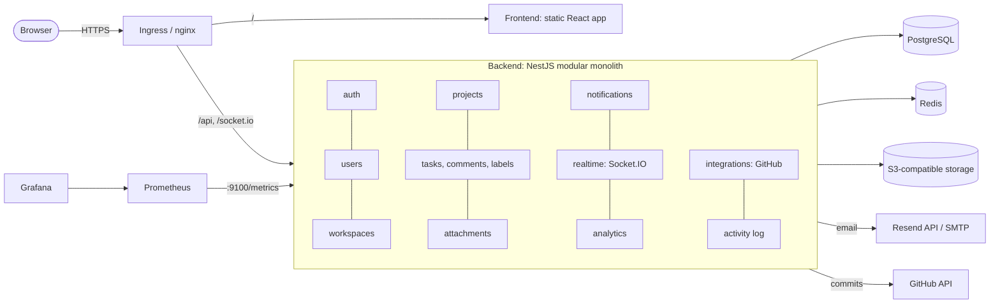
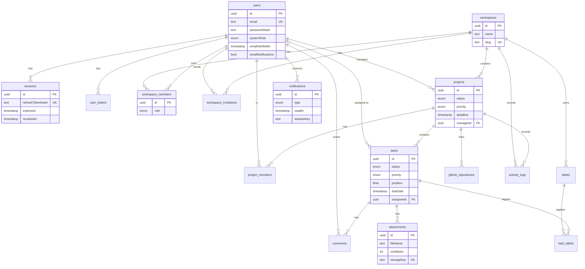

# Architecture

## System overview

Metrics are served on a separate port (9100) that the ingress never routes to.

## Modules and how they talk

Modules own their controllers, services and DTOs and use each other only through exported services or **domain events** (`src/common/events.ts`), so any module can later become a service:

| Event | Emitted by | Consumed by |
|---|---|---|
| `task.assigned`, `task.commented`, `project.updated`, `invitation.created` | tasks, comments, projects, invitations | notifications (in-app + email) |
| `notification.created`, `task.changed` | notifications, tasks | realtime gateway (Socket.IO push) |
| `files.orphaned` | tasks, projects, workspaces | attachments (deletes stored files) |

## Request flow: authorisation

1. Global `JwtAuthGuard` authenticates every route except those marked `@Public()`; the user is reloaded from the database on each request.
2. `WorkspaceRolesGuard` (on `workspaces/:workspaceId/...` routes) checks membership and the minimum role. Non-members get 404.
3. Services add the finer rules (project manager vs admin, developers only in projects they belong to).

## Data model

Indexes follow the access patterns: `tasks(projectId, status, position)` for the board, `tasks(assigneeId)` and `tasks(dueDate)` for dashboards and reminders, `activity_logs(projectId, createdAt)` for history, `notifications(userId, readAt, createdAt)` for the bell, and unique token hashes for single-use links.

## Key decisions

- **Modular monolith** first; events and exported services mark the future seams.
- **Kanban order** is a `Float position` per task: a drop writes one row (midpoint of the neighbours) and a column is renumbered only when neighbours get too close.
- **Refresh tokens** are random, stored hashed, rotated on use; replaying a used token revokes the whole user's sessions.
- **Single-use links** (verify, reset, invite) are claimed atomically with `updateMany ... where usedAt is null`, so two requests cannot both succeed.
- **Uploads** pass through the API (size/type checked, random storage keys); downloads are short-lived presigned links that force a download.
- **Migrations** are a separate deploy step (Kubernetes Job / Helm hook), never run by app pods at startup.
